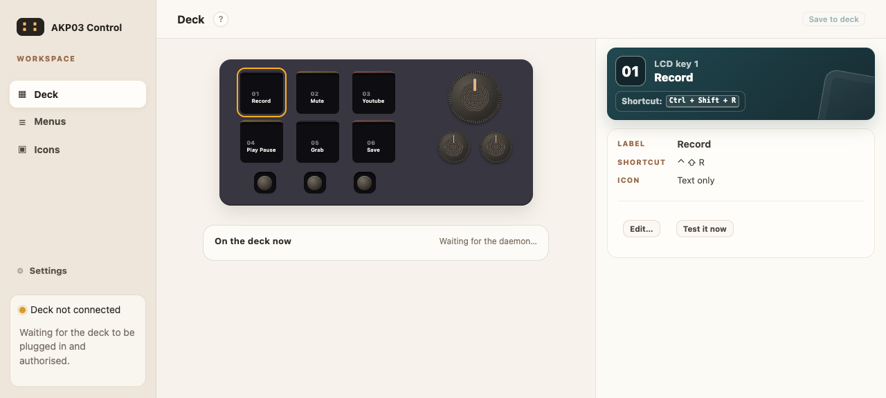
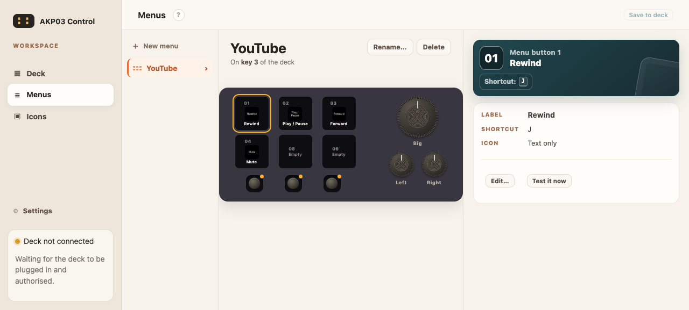
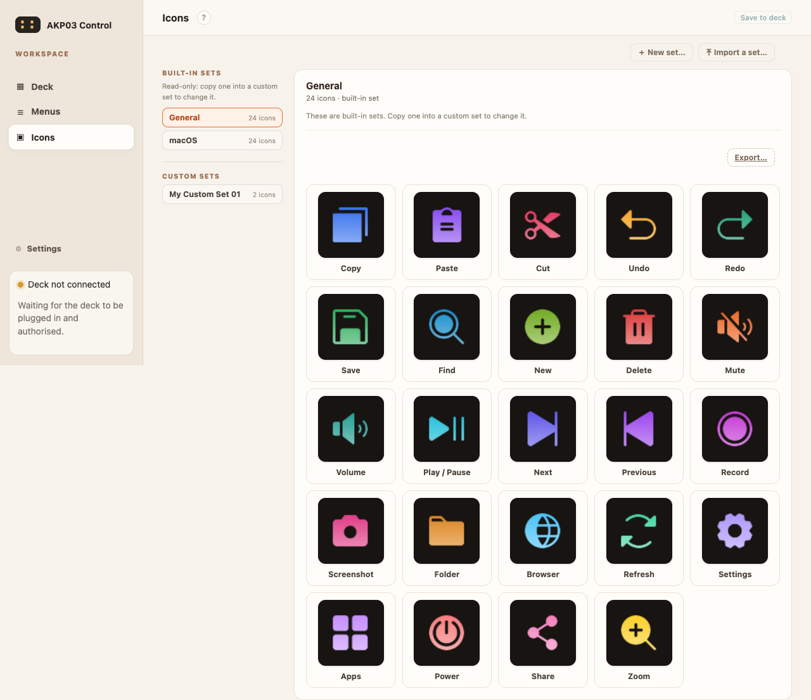

# AKP03 control deck

An editor and a menu-bar app for the **AKP03 macro pad** on macOS: six LCD keys, three
buttons underneath, and three dials — all of them yours to assign.



The pad itself is cheap and plain. The software that usually comes with it is not the
point. This is: one page where you say what every control does, and the deck in front of
you starts doing it.

## What it does

- **Every control is assignable.** A key fires a shortcut on a tap, or holds it down while
  you hold the key. Each dial has a slot for its press and for each way it turns, so one
  dial can be light, another volume, another scrubbing a video.
- **Menus.** A key can open a menu of its own: its own labels, its own buttons, and which
  parts of the dials it takes over while it is open. The **left dial's press always goes
  back** — a menu you cannot leave is a brick.
- **One draft for the whole app.** Deck, Menus and Icons are three views of the same
  pending change. Nothing is written until you press **Save to deck**.
- **Single-key shortcuts.** YouTube rewinds on `j` and fast-forwards on `l`; those are
  single keys, and they work here. Where a bare letter could land in a text field, the
  editor says so on the assignment rather than refusing it.
- **Icons.** Two sets ship with the app; bring your own pictures or a whole set, and copy
  one set's pictures into another.
- **It blanks when idle**, to spare the little screens, without ever blanking while a key
  is held.
- **Backup and restore.** One file holds your setup and the pictures something points at,
  so a menu comes back with its faces instead of blank keys. Restoring loads the draft —
  nothing on the deck changes until you save.

## The three pages

Deck, Menus and Icons edit **one draft**. Menus are their own screens, with their own
labels, buttons and dial claims:



Icons are the pictures a key can show. Two sets ship with the app, and you can bring your
own or import a whole set:



## Installing

The editor and the daemon run from the app; there is nothing else to install.

1. Build it (see below), or download the `.dmg` from the
   [latest release](https://github.com/trentster/akp03-control-deck/releases/latest).
2. Drag **AKP03** into **Applications**.
3. Open it with **right-click → Open** the first time.
4. Grant the two permissions it asks for, both to **AKP03**:
   - **Input Monitoring** — so the deck's buttons can be read
   - **Accessibility** — so it can type the shortcuts you bind

If a permission is missing and AKP03 is not in that list, click **+** in the pane and add
it from Applications. Then quit the app and open it again.

Plug the deck in whenever you like — it is found whether it was already connected or
arrives later.

## Using it

Click the menu-bar icon and choose **Configure AKP03**. The editor opens in your browser
on loopback only: nothing on your network can reach it.

Pick a control on the deck drawing, say what it does, press **Save to deck**. A shortcut
can be tried first with **Test it now**, which does not save anything.

## Building it

Needs macOS, the Xcode command line tools, and Python 3.10 or newer.

```sh
python3 -m venv .venv
./.venv/bin/pip install -e .
bash macos-menubar/Scripts/build-app.sh     # writes dist/AKP03-<version>.dmg
```

## Working on it

```sh
TMPDIR=/tmp .venv/bin/python -m pytest -o addopts="" -q    # the Python suite
bash macos-menubar/Scripts/verify.sh                        # the Swift checks
```

`docs/internals.md` covers how the daemon behaves: device selection, keyboard backends,
the stream from the deck, menus, and the exact rules for dial slots.

## Licence

MIT — see [LICENCE](LICENCE). The icon art that ships with the app comes from open sets,
each with its own licence.
